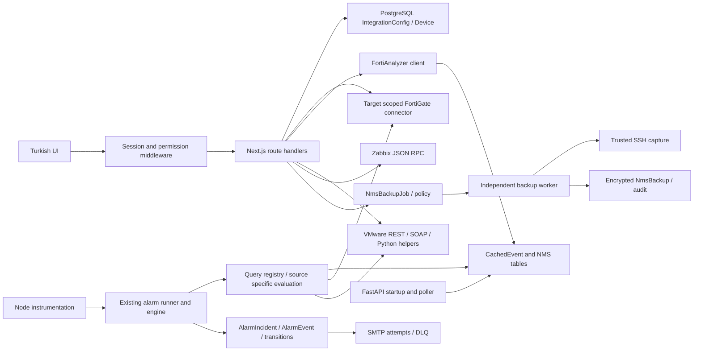

# InfraScope Birleşme Sonrası Mimari ve Davranış Tutarlılığı Denetimi

**Tarih:** 2026-10-15  
**İncelenen HEAD:** `816e6036fea121be4402fcdc81a68aaadda7331e` (`main`)  
**İncelenen durum:** HEAD + aşağıda belirtilen mevcut çalışma ağacı  
**Yöntem:** Statik çağrı zinciri ve seçilmiş Git diff incelemesi; ağ erişimi kapalı, salt okunur kaynak bağlamalarıyla mevcut kontroller ve sentetik davranış deneyleri  
**Değişiklik:** Yalnızca bu rapor. Uygulama kodu, bağımlılıklar, mevcut belgeler ve kurulum veritabanı değiştirilmedi.

## 1. Sonuç ve kanıt sınırı

Uygulama, tek şirkete ait Next.js uygulaması ve PostgreSQL veritabanı ile bunlara bağlı Python NMS servisi olarak çalışıyor. Bu kurulum modeliyle çelişen bir paylaşımlı tenant mimarisi dayatılmamalı. Ancak aynı şirketin farklı entegrasyon hedeflerinin, bağlantı kimliklerinin ve olaylarının birbirinden ayrılması gerekiyor.

En önemli doğrulanmış sorunlar şunlar:

- Fortinet olay türü kimliği bazı aktif alarm yollarında olay örneği kimliği olarak kullanılıyor; sonraki gerçek olay, kapatılmış bir incident'e ait tekrar sayılarak kaybolabiliyor (**B01**).
- Kaynak bağlantı/sorgu hataları bazı aktif yollarda hatasız boş sonuca çevriliyor (**B02**).
- VMware ve FortiGate kaynağına özel alarm değerlendirmesine ulaşılması hâlâ FortiAnalyzer yapılandırmasına bağlı (**B03**).
- Eski entegrasyon uçları ile yeni firewall/yedek uçları aynı yetki kurallarını uygulamıyor (**B04**).
- FortiAnalyzer testi başka kimlik bilgileriyle açılmış oturumu kullanabiliyor; ayar değişikliği kalıcı event-cache istemcisini değiştirmiyor (**B05–B06**).
- VMware önbelleği, arka plan yenilemesi ve Python yardımcı yolu farklı sözleşmeler kullanıyor (**B07–B08**).

Bu rapor, başka müşteride yaşanmış belirli arızanın adli kök neden tespiti değildir: o kurulumun hata anındaki sürümü, anonimleştirilmiş hata izi, ortam değişkenleri ve migration durumu mevcut değil. Aşağıdaki hatalar depoda doğrulandı; söz konusu müşteri olayını bunlardan hangisinin oluşturduğu ayrıca doğrulanmalıdır. Canlı müşteri verisi, parola, token veya anahtar bu rapora alınmadı.

**Kanıt seviyeleri:** “Doğrulanmış” çalıştırılmış sentetik deney veya açıkça izlenmiş aktif kod davranışıdır; gerçek cihazda doğrulama anlamına gelmez. “Güçlü şüphe” mekanizması görünür olup tetiklenme koşulu/işletim sözleşmesi henüz tamamlanmamış durumdur. “Doğrulanmamış olasılık” için yeterli yürütme veya kurulum kanıtı yoktur. Öncelik, kanıt seviyesinden ayrıdır. P1 önemli veri/izleme/yetki kaybı; P2 sınırlı kapsam veya kurulum tutarsızlığı; P3 bakım ve doğrulama borcudur. P0 olarak doğrulanmış bir kurulum kesintisi ileri sürülmüyor.

## 2. Proje kuralları ve belge–kod ayrımı

Çalışma alanında ve kontrol edilen üst dizinlerde `AGENTS.md` veya `PROJECT_BOOT` bulunmadı. Gerçek anayasa `docs/00-product/CONSTITUTION.md`; önceki denetimde anılan farklı anayasa adı mevcut değil. Belge varlığı veya “uygulandı” ifadesi, davranış kanıtı olarak kabul edilmedi.

| Kaynak | İnceleme | Beklenen davranış / güncellik notu |
|---|---|---|
| `docs/README.md`, `docs/00-product/CONSTITUTION.md` | Okundu | Gerçek veri, kaynak/cache ayrımı, session hijyeni, ortak Prisma, idempotent görevler; tek organizasyon. Kod/yorum/log İngilizce, UI Türkçe. |
| `docs/10-architecture/OVERVIEW.md`, `BOUNDED_CONTEXTS.md` | Mimari ve sözleşme bölümleri incelendi | Entegrasyonların sahipliği ve veri akışı yararlı; singleton, tablo/alan adları ve eski yedek zamanlaması tamamen güncel değil. |
| `docs/10-architecture/IMPROVEMENTS_ANALYSIS.md` | Mevcut mimari ve öneri bölümleri incelendi | REST/SOAP/PyVmomi alternatiflerinin gerekçesi var. Önerilen event-cache üreticisi uygulanmış kabul edilmedi. |
| `docs/10-architecture/adr/ADR-001...ADR-007` | Karar ve sonuç bölümleri okundu | CMDB diff'in bilinçli devreden çıkarılması, registry, FA session yaşamı, port eşlemesi, hedef kapsamlı FG, kalıcı firewall kimliği, dayanıklı yedek işleri. |
| `docs/20-modules/integrations/{README,fortianalyzer,fortigate,vmware,nms}.md` | Okundu | Protokol ve giriş noktaları; VMware singleton/event persistence ve eski FG SNMP anlatımı kodla uyuşmuyor. |
| `docs/30-runbooks/ALARM_CHECK_HEALTH.md`, `FA_ACCOUNT_LOCKED.md`, `DUPLICATE_PORT_DOWN_EVENTS.md`, `DATASTORE_CRITICAL.md`, `nms-backups.md` | İlgili operasyon adımları okundu | Son alarm sağlığı düzeltmesinin yalnızca bağımsız NMS kapsamı doğrulandı. “Bir daha kilitlenmez” gibi kesin ifadeler bu denetimde garanti sayılmadı. |
| `docs/30-runbooks/CUSTOMER_DEMO_INSTALL.md`, `NMS_BACKUP_RELEASE_VALIDATION.md` | Kurulum modeli ve önceki doğrulama/sınır bölümleri incelendi | Ayrı müşteri kurulumu ve anahtar korunumu; geçmiş test sonuçları bu denetimde yeniden çalıştırılmış sayılmadı. |
| `CHANGELOG.md`, `README.md` | Güncel değişiklikler ve yönlendirmeler incelendi | Commit edilmemiş dashboard açıklamaları dahil; bunlar HEAD'e ait kanıtla karıştırılmadı. |
| `docs/audits/ALARM_LIFECYCLE_AUDIT.md`, `docs/QUEST_MODE_GUIDE.md` | Önceki bulgular/yöntem ve ilgili yönlendirmeler incelendi | Eski lifecycle eksikleri mevcut `AlarmIncident` modeli eklenmeden önceki durumu anlatıyor. Güncel hata diye tekrar edilmedi. |

Önemli belge sapmaları:

1. Constitution:86 “custom auth yok, SSO/OAuth” derken `lib/auth/session.ts` ve `middleware.ts:73` uygulama JWT oturumunu doğruluyor. Bu, mevcut auth'u bu raporda kaldırma önerisi değildir; kararı belgelemek gerekir.
2. Entegrasyon README'sindeki VMware singleton iddiasına karşı API `getVMwareService()` yeni istemci oluşturuyor (`app/api/integrations/vmware/route.ts:157`); health ayrıca ENV kullanıyor (`app/api/health/route.ts:177`).
3. VMware eventlerinin `cached_events` üzerinden kalıcı toplandığı anlatımı, `lib/alarms/queries/vmware.ts:20` içindeki “event sync eklendiğinde” açıklaması ve aktif doğrudan servis değerlendirmesiyle aynı değildir.
4. NMS dokümanındaki `nmsInterface` tablo adı/örnek alanlar fiziksel sözleşme değildir: gerçek tablo `nms_interfaces`, zaman alanı `collected_at`; Prisma ve SQLAlchemy eşlemeleri esas alınmalıdır.
5. Güncel yedek sözleşmesi ADR-007 ve `nms-backups.md` içindeki PostgreSQL kuyruğudur. Eski beş dakikalık otomatik SSH backup anlatımı güncel iş akışı değildir.

Bu aşamada kullanıcı yalnızca tek rapor istediğinden Constitution'daki genel belge/changelog güncelleme alışkanlığı başka dosyalara uygulanmadı. Sonraki düzeltmelerde İngilizce kod/yorum/log, Türkçe kullanıcı mesajları korunmalıdır.

## 3. Depo durumu ve gerçek teknoloji yığını

Git geçmişi 96 commit içeriyor; shallow değil. `git log --all --merges` sonuç vermedi. Bu, iki uygulamanın birleşmediğini kanıtlamaz; eldeki geçmişte iki özgün uygulamayı ilişkilendiren merge parent'ları yok. İçe aktarma/squash öncesi geçmiş ve özgün depolar olmadan kesin birleşme soyağacı çıkarılamaz.

Başlangıç ve son kontrolde izlenen dosyalara ait diff özeti aynı kaldı:

```text
git diff --binary | git hash-object --stdin
7a4cf5197eed8210871a29d6c0b88b67d12afd93
```

Başlangıçta mevcut, bu çalışma tarafından değiştirilmemiş izlenen dosyalar:

```text
CHANGELOG.md
README.md
app/api/dashboard/summary/route.ts
app/dashboard/alerts/page.tsx
app/dashboard/loading.tsx
app/dashboard/page.tsx
components/dashboard/types.ts
components/layout/Header.tsx
components/layout/LayoutShell.tsx
lib/api.ts
package.json
```

Başlangıçtaki izlenmeyen dosya/dizinler:

```text
.github/workflows/dashboard-checks.yml
.machine-id
app/api/dashboard/analytics/
app/api/dashboard/search/
components/dashboard/DashboardSearch.tsx
components/dashboard/IncidentDetail.tsx
components/dashboard/ResourceCharts.tsx
components/dashboard/dashboard.module.css
design-qa.md
docs/dashboard.md
lib/dashboard/
public/images/dashboard/
scripts/check-dashboard.cjs
```

`.machine-id` içeriği okunmadı; kurulum kimliği olarak bırakıldı. `git reset`, `checkout`, `clean`, commit veya push yapılmadı. Dashboard kontrolünün mevcut commit edilmemiş dosyaları da kapsadığı özellikle dikkate alınmalıdır.

| Katman | Doğrulanan sürüm/kaynak |
|---|---|
| Web runtime | Node **20.20.2**, mevcut web imajında `node --version` |
| Next / React | **14.2.35 / 18.3.1**, `package-lock.json`; Next sürümü build çıktısıyla da doğrulandı |
| TypeScript / Prisma | **5.9.3 / 5.22.0**, lockfile; Prisma client de 5.22.0 |
| Stil/grafik | Tailwind **3.4.19**; Recharts/SWR manifestte; bu paketlerin tüm transitif uyumlulukları ayrıca değerlendirilmedi |
| Ağ/bildirim | undici **6.26.0**, nodemailer **6.10.1**, jose **6.2.3**, node-cron **4.2.1**, lockfile |
| NMS runtime | Python **3.11.17**, FastAPI **0.110.0**, SQLAlchemy **2.0.29**, Pydantic **2.6.4**, Paramiko **3.4.0**, cryptography **43.0.3**, mevcut NMS imajında paket metadata'sı |
| SNMP | Aktif `nms_service/snmp/session.py` net-snmp `snmpget/snmpbulkwalk` subprocess kullanıyor. İmajda pysnmp **4.4.12** hâlâ kurulu; etkin kullanımı bu taramada bulunmadı. |
| Veritabanı | Prisma provider PostgreSQL; repoda **20 migration dizini**. Canlı sunucunun major sürümü, uygulanmış migration listesi ve gerçek constraint'leri sorgulanmadı. |

Manifestteki `^` aralıkları kilitli sürüm değildir. Python requirements aralıkları da mevcut imajda saptanan sürümlerden ayrıdır. PyVmomi web uygulamasının aktif snapshot/host yardımcıları için ek runtime bağımlılığıdır; NMS bağımlılığı sayılması bu yolu sağlamaz.

## 4. Değişiklik geçmişi ve eski/yeni eşleştirmesi

Seçilmiş commit içerikleri/diff'leri ile çağrı noktaları karşılaştırıldı. Diğer satırlar tarihçe işaretidir; tüm commitlerin tüm değişiklikleri incelenmiş değildir.

| Commit / tarih | Değişim ve bugünkü karşılığı |
|---|---|
| `96d2ffd` / 2026-01-13 | Elde bulunan ilk commit; öncesi mevcut değil. |
| `1f92311` / 2026-02-03, `232cf06` / 02-11 | Fortinet/entegrasyon ve kapsamlı alarm katmanlarının gelişimi; mevcut `lib/integrations`, alarm API/engine ailesinin öncülleri. |
| `86c102c` / 02-18 | Diff: VMware host/VM toplamasına PyVmomi ve `scripts/get-host-details.py` eklenmesi. REST tamamen kaldırılmamış. |
| `3439572` / 02-19 | Python subprocess timeout/kill davranışının değiştirilmesi. Aktif snapshot yolunda hâlâ `execSync` var. |
| `f6a6c03` / 03-12 | Ortak alarm runner yönü; güncel scheduler/watchdog doğrudan `runAlarmCheck()` çağırıyor. |
| `651bda4` / 03-13, `0d3af56` / 03-19 | VMware changes API eklenip kaldırılmış. Eski endpointin tarihçede görülmesi bugünkü aktif çağrı kanıtı değil. |
| `dd76523` / 04-01, `d7b2527` / 04-13 | NMS API ve backup UI yolları. |
| `689d69d` / 04-02 | Diff: FortiGate token yanında kullanıcı/parola ve APSCOOKIE/CSRF desteği. Alternatif auth yöntemleri bilinçli. |
| `75b9b68` / 04-10 | FA boş sonucunda NMS cache fallback gelişimi; güncel kaynak ayrımı yeni engine/registry kodundan değerlendirildi. |
| `d591263` / 04-27, `4f8fd7a` / 04-28 | Diff/stat: pysnmp yerine net-snmp CLI, ardından SSH polling fallback. Eski bağımlılık listesiyle etkin taşıma ayrışmış. |
| `027a86d` / 04-29 | FortiGate stale-while-revalidate yaklaşımı; güncel cache hedef kapsamı ayrıca değişmiş. |
| `ac2f8e4` / 06-01, `959c17c` / 06-04, `c669dee` / 06-08 | RBAC, API auth/rate limit ve lisans güvenlik katmanları. Eski route'ların bu katmana tam bağlanmadığı B04'te gösterildi. |
| `d9b44a6` / 07-10 | Eksik NMS interface migration'ı. Geçmiş kurulum şema sapması ihtimalini destekler; canlı DB'nin bugün eksik olduğunu kanıtlamaz. |
| `a000945` / 07-14 | 136 dosyalık firewall revizyonu: connector factory, kalıcı kimlik, yetki, şifreleme, kaynak zarfları, recovery. Eski `/api/integrations/fortigate` kullanımda kalmış. |
| `95ae3f5` / 10-14 | NMS alarm bağımsızlığı ve pipeline health. |
| `fa39f8e` / 10-14 | Login rate limit havuzunun genel API'den ayrılması. Bu denetimde canlı login denenmedi. |
| `1cf9a4d` / 10-14, `7027760` / 10-15 | Genel backup kayıtları, ardından dayanıklı job/worker/policy sözleşmesi. |
| `816e603` / 10-15 | Diff: olmayan opsiyonel FA'yı NMS kontrol hatası saymama ve başarılı kontrol sonrası health recovery. VMware bağımlılığını kaldıran bir değişiklik değil. |

| Eski/yeni yüzey | Aktif kullanım kanıtı | Değerlendirme |
|---|---|---|
| Eski FG API ↔ yeni `/api/firewalls/[id]/*` | `app/network/firewall/page.tsx:112`, `ssl-vpn/page.tsx:62` eski API; `app/integrations/firewall/[id]/page.tsx:32` yeni kaynak uçları | İkisi de çağrılıyor. Yeni factory ortak, UI sözleşmeleri farklı; otomatik silinecek kopya değiller. |
| Per-call FG istemcisi ↔ factory registry | `connector-factory.ts:189`, `:228`; eski route da factory kullanıyor | Paylaşılan istemci ve kayıt dışı test istemcisi bilinçli ayrım. |
| Host temelli firewall kimliği ↔ kalıcı seri/VDOM | `connector-factory.ts:133-153`, `prisma/schema.prisma:880` | Legacy host fallback var; yeni kimlik bağlama/conflict akışı otomatik birleştirmeyi engelliyor. |
| FA istemci singleton ↔ host-global auth state | `fortianalyzer.ts:1151`, `:124`, test route `:99` | İstemci fingerprint'i dönüyor, auth state aynı kapsamı kullanmıyor. |
| FA live sorgu ↔ PostgreSQL EventCache | `queries/base.ts:41`, `event-cache.ts:54` | Amaçlı cache+source; sorun kopya olmaları değil, hata ve ayar revizyonu sözleşmeleri. |
| VMware REST ↔ SOAP ↔ PyVmomi | `vmware.ts:696`, SOAP/event metotları, `:2049`; engine `:1602` | Farklı vSphere yetenekleri için alternatifler. Test/lifecycle/TLS/dağıtım bağımlılıkları eşit değil. |
| pysnmp ↔ net-snmp subprocess | `nms_service/snmp/session.py:3` ve mevcut poller importları | Aktif taşıma CLI; requirements içindeki pysnmp kullanılmayan bağımlılık adayı. |
| SNMP polling ↔ SSH fallback | `orchestrator.py:315-398` | Bilinçli fallback. Backup worker bu polling oturumlarından bağımsız çalışıyor. |
| Senkron backup endpointi ↔ durable job | `nms_service/main.py:251`, `lib/nms/backup-service.ts:21`, `nms_service/backup_worker.py:65` | Eski NMS capture isteği 410; güncel UI kalıcı kuyruğu kullanıyor. |
| Eski alarm occurrence ↔ incident lifecycle | `incident-service.ts:151`, `schema.prisma:1127` | Mevcut incident/transition/dedup var. Önceki lifecycle denetiminin eksikleri doğrudan bugünkü duruma taşınamaz. |

## 5. Mevcut mimari ve aktif giriş noktaları



Gerçek runtime başlangıcı `instrumentation.ts` → `instrumentation-node.ts:10` → credential migration → alarm catalog sync → runner init → alarm scheduler → watchdog → retention → firewall recovery. Lisans sunucusu modu bu müşteri görevlerini başlatmıyor. Bu giriş noktası, API dosyasının varlığından daha güçlü bir çalışma kanıtıdır.

Web tarafında ortak Prisma `lib/prisma.ts`; VMware ve Zabbix modüllerinde ayrıca `new PrismaClient()` var (`vmware.ts:19`, `zabbix.ts:13`). Bu, ortak havuz kuralından sapma; bu denetimde havuz tükenmesi ölçülmedi. Python modelleri ikinci müşteri veritabanı değil, aynı PostgreSQL tablolarının kısmi SQLAlchemy eşlemesi (`nms_service/database/models.py:43`).

### 5.1 Ayar, kimlik bilgisi ve hedef matrisi

| Entegrasyon | Ayar oluşturma/düzenleme/kaydetme | Gerçek çözümleme | Hedef/veri kimliği |
|---|---|---|---|
| FortiAnalyzer | UI `app/integrations/fortianalyzer/page.tsx:60,82` → POST `app/api/integrations/fortianalyzer/route.ts:70`; `save-config:108` → encrypted upsert `:134` | DB `IntegrationConfig(FORTIANALYZER)`; `unprotectIntegrationConfig`; boş parola mevcut kayıttan; client factory fingerprint host/user/secret | Çoğu legacy tüketici ilk kayıt; oturum host anahtarlı; sorgularda ADOM `root`. |
| FortiGate legacy | POST `/api/integrations/fortigate`, `save-config:486` → protect `:524` → upsert → factory clear `:554` | `configId/VDOM` selector; factory `resolveFortiGateTarget:120`; encrypted parola/token | `IntegrationConfig.id:VDOM`; legacy host/inventory fallback. |
| Firewall yeni | UI liste/detay → `/api/firewalls` POST `:119` transaction `:140`, `[id]/route.ts:84` PATCH → encrypted config + connector + Device → probe | `FirewallConnector` üzerinden seçilmiş config; aynı factory; REST cookie/token; ayrı SNMP/SSH credential alanları | Seri/devid + VDOM, envanter Device CUID, ayrı integer NMS ID; pending/verified/conflict durumları. |
| VMware | `app/integrations/vmware/page.tsx:176,195` → POST `save-config:922` → upsert `:947` | DB JSON; boş parola ilk mevcut kayıttan; host normalizasyonu var; parola şifreleme profiline bağlı değil | İlk enabled vCenter; kaynak kimliğiyle kapsamlanmamış MoRef; global response/snapshot cache. |
| Zabbix | POST `/api/integrations/zabbix/route.ts:157` → upsert `:170` | DB JSON `authToken`; secret envelope yok; `authenticate:130` önce password'süz `user.login` çağırıyor | İlk enabled Zabbix; `Device.zabbixHostId`, `ZabbixTrigger.triggerid`; kaynak config kapsamı yok. Ayar UI çağırıcısı bu taramada bulunmadı. |
| NMS polling/SSH | `add-device/page.tsx:139`, edit `:293` → devices POST `:79` / `[id]/route.ts:147` PUT → Device encrypted secrets | Poller her cycle DB'yi yeniden okur; Python `decrypt_nms_credential`; SNMPv1/v2c/v3; onaylı host key ile SSH | Next route `[id]` CUID; Python metric/FK `nms_device_id` integer. İkisi eş anlamlı değil. |
| NMS backup | Genel/device UI → `enqueueDeviceBackup:21`; policy API → policy kaydı | Worker capture anında Device ve güncel encrypted SSH credential'ı tekrar okur (`backup_worker.py:83`); polling session'ına bağlı değil | Job inventory CUID + NMS integer + aktif cihaz anahtarı; artifact silinen inventory sonrası nullable ilişkiyle arşivde kalır. |

### 5.2 Bağlantı testi, manuel ve zamanlanmış toplama matrisi

| Entegrasyon | Bağlantıyı test etme | Manuel veri alma | Zamanlanmış/arka plan yolu |
|---|---|---|---|
| FA | POST `action=test:75` → temporary `FortiAnalyzerService.login`; yalnızca login, veri yetkisi/ADOM testi değil; B05 | GET `type=status/adoms/...:170` → saved config → shared service; manuel alarm `/api/alarms/check:18` → runner | İlk uygun alarm kontrolünde `initializeEventCache:226` → `startBackgroundSync:54`; ilk sync ve 5 dk taban/backoff timer. Ayrı genel inventory sync scheduler bulunmadı. |
| FG legacy/yeni | Legacy POST test `:381` → ephemeral factory `:410` → status. Yeni onboarding/edit/manual probe → `lib/firewall/probe.ts:22` → selected connector `getStatus` → identity/capabilities persistence | Legacy `action=sync:455` → `syncToInventory:700`; yeni detail resource GET → `executeFirewallRestRead:31`; SSH/SNMP kaynakları ayrı read servisleri | 60 sn recovery scheduler yalnızca uygun probe'ları claim eder; tam inventory sync değildir. Network UI'nin 30 sn/5 dk GET yenilemesi server scheduler sayılmaz. Alarm runner direkt FG metotlarını da kullanır. |
| VMware | POST test `:811` → yeni servis → `getStatus:1788` REST authenticate/version | POST sync `:841,895` → DB config → `syncToInventory:1567`; GET snapshots `:649` → PyVmomi veya servis snapshot yolu | Alarm scheduler → engine `initializeVMware:127` DB config → `evaluateVMwareAlarm` doğrudan REST/SOAP/Python. API SWR self-fetch `:258` sorunlu (B07). `syncInterval` kullanan kalıcı inventory job bulunmadı. |
| Zabbix | POST test `:63` → `getStatus:421` → `authenticate:130` | POST sync `:86` → ilk enabled config → `syncToInventory:255` | Repo içi bu sync'i çağıran periyodik iş bulunmadı; `pollingInterval/syncInterval` kaydı kendi başına görev başlatmıyor. Harici cron varlığı doğrulanmadı. |
| NMS | Genel cihaz formunda tek birleşik “SNMP+SSH çalışıyor” test zinciri saptanmadı. Discovery SNMP yanıtını, host-key inspection SSH kimliğini sınar; ikisi backup capture başarı testi değildir. Yeni firewall SNMP/SSH read uçları ayrı kaynak sonuçları verir. | UI metric okumaları DB read'leri. FastAPI `main.py:154 trigger_poll` gerçek route olarak mevcut, fakat repo içi Next/UI çağırıcısı bulunmadı; bu yol sadece SNMP session kullanır. | FastAPI startup `:67` → daemon orchestrator → `run:515` → register DB `:99` → `poll_cycle:459` → `_poll_single_device:266` → SNMP → gerekirse SSH. |
| NMS backup | SSH host-key inspection/approval bağlantı güvenini sağlar; gerçek command/output yeteneği job işlenirken doğrulanır | UI POST → transaction ile job+audit → HTTP 202; başarı anlamı artifact değil kabul. Worker `claim:65` → `process:159` → capture → `_complete:116` | FastAPI startup ayrıca `backup_worker.start:70`; opt-in policy scheduler `maintenance_tick:208`, retention ayrı transaction; retry/lease/fencing mevcut. Eski senkron endpoint 410. |

### 5.3 Dönüştürme, kayıt, alarm ve bildirim matrisi

| Kaynak | Dönüştürme/kayıt | Alarm değerlendirmesi | Bildirim |
|---|---|---|---|
| FA | `EventCacheService.syncAllEventTypes:124` → search/poll → `saveEvents:366`; `logid + eventtime/itime_t`, `devid/VDOM`, parse time → `CachedEvent` upsert | Registry `queries/index.ts:245`; `runAlarmQuery:41` cache-first/live; engine `performLogSearch:1325` → grup/filter/threshold → `fireAlarm:2222` | `recordAlarmOccurrence:278` → `AlarmIncident/AlarmEvent` → `sendAlarmEmail:2304`; source ID/dedup B01, hatalı boş sonuç B02. |
| FG | Legacy sync → Device/NetworkInterface/FirewallPolicy vb.; yeni probe → connector capability/identity + Device metadata snapshot; yeni reads available/stale/unavailable zarfı | Mevcut engine'in FortiGate kaynağına özel metotları; CMDB alarm registry girişlerinin bilinçli kapatıldığı `queries/index.ts:247` açık. Sadece query dosyasının bulunması aktif alarm kanıtı değil. | Aynı incident/email altyapısı; yeni bir alarm motoru gerekmiyor. |
| VMware | REST/SOAP/Python → normalize edilmiş host/VM/datastore/snapshot; sync → `VMwareCluster`, `Device`, `VMwareDatastore`, ilişkiler; snapshots GET'in çoğu canlı/cache cevabı, tümü `VmSnapshot` yazımı sayılmaz | `evaluateVMwareAlarm`; özel vCenter metotları. Registry'nin gelecekteki `cached_events.source=vmware` okuması bugün çalışan event üreticisi diye sunulamaz. | `fireAlarm` → aynı incident/email. B03 nedeniyle bu aşamaya erişim FA'ya bağlı. |
| Zabbix | `syncToInventory:255` host/interface/trigger dönüşümü → Device, NetworkInterface, ZabbixTrigger; epoch saniyeleri `*1000` | ZabbixTrigger kaydından mevcut InfraScope incident motoruna otomatik köprü bu taramada bulunmadı. Trigger kaydı alarm bildirimi kanıtı değil. | Zabbix sync için otomatik SMTP zinciri bulunmadı; harici Zabbix bildirimleri incelenmedi. |
| NMS | `database/repository.py:71` interface upsert ve up/down baseline; `:161` metric yazımı; UTC naive datetime → Prisma DateTime; NMS integer FK kullanılır | Runner önce `evaluateNmsAlarms:3954`; fresh data, monitored/up baseline, cooldown, `recordAlarmOccurrence`, recovery; backup registry `databaseOnly` | Alarm email tercihi varsa ortak servis. Backup failure kuralı için dokümante varsayılan email kapalı. |
| Backup | Fixed platform profile + trusted SSH → EOF/prompt/structure validation → AES-GCM artifact + SHA-256 + terminal job/audit tek commit (`backup_worker.py:116`) | `NMS_BACKUP_FAILED` gerçek terminal job/policy overdue DB durumunu sorgular; FA kaynağı gerektirmez; recovery aynı motorla | Başarı HTTP 202'de değil job/artifact'ta; email alarm tercihine bağlı. |

Ortak SMTP ayarı `/api/alarms/notification`: PUT `:69` → `NotificationConfig(channel=email)`; POST `:115` gerçek test email'i gönderir. Bu nedenle canlı çağrılmadı. `email.ts:104` her gönderimde DB ayarını okur; transporter fingerprint'i host/port/user/password/secure içerir (`:139`), dolayısıyla burada credential değişimini yok sayan bir cache hatası saptanmadı. Başarısız gönderimler attempt/DLQ kaydına gider; `dlq-worker.ts:89` alarm kontrolünün sonunda bounded retry yapar. Saatlik limit ve cooldown process-local; gerçek teslimat ve alıcı politikası doğrulanmadı.

### 5.4 Görevlerin başlama ve kapsam kontrolü

| İş | Giriş / koruma | Sınır |
|---|---|---|
| Alarm scheduler | `instrumentation-node.ts:16` → `lib/alarm-scheduler.ts:116`; global timer + tick guard; hemen ilk çalışma, sonra 10 dk | Runner DB guard atomik değil; B19. |
| Watchdog | `instrumentation-node.ts:17` → `alarm-monitor.ts:43`; 5 dk başlangıç gecikmesi, 15 dk kontrol | Aynı runner'ı kurtarma amacıyla çağırır; ikinci alarm motoru değildir. Son logun yakınlığı kaynak başarısının garantisi değil. |
| FA event sync | Engine içinde lazy `initializeEventCache`; recursive timeout/backoff | Modül-local init flag, config revision/stop lifecycle eksik; B06/B19. |
| Alarm retention | `retention-service.ts:217`; yerel 02:30 ilk çalışma, ardından 24 saat; DB lease | İlk çalışmadan önce startup timer ayrıca guard edilmiyor; iki init çağrısı iki timer kurabilir. DB lease aynı anda çalışmayı kısmen korur. |
| Firewall recovery | `recovery-scheduler.ts:135`; 5 sn sonra, 60 sn interval; DB claim/advisory lock | Kasıtlı kaynak probe'u, inventory sync değil. |
| NMS polling | FastAPI startup → orchestrator daemon/thread pool | Ayar her cycle yeniden yükleniyor; silinen/disabled session'lar unregister ediliyor (`orchestrator.py:111-116`). |
| Backup worker/scheduler | FastAPI startup; PostgreSQL `SKIP LOCKED`, token/lease ve device advisory lock | Alarm motorundan bağımsız, önceki senkron modelle aynı anda yeni capture üretmesi amaçlanmıyor. Fiziksel worker testleri bu audit'te çalışmadı. |

Credential migration veya catalog sync'in başlangıçta throw etmesi daha sonraki scheduler start'larına ulaşılmasını engeller (`instrumentation-node.ts:13-19`). Bu akış statik olarak açık; anahtar kaybında kontrollü fail-closed başlangıç mı, bağımsız NMS işlerinin de durması istenmeyen sonuç mu, işletim kararı doğrulanmadı. Başarısız bootstrap için ayrı health/başlatılmamış iş göstergesi önerilir; bunun canlı kurulumda meydana geldiği ileri sürülmüyor.

## 6. Önceliklendirilmiş bulgular

### B01 — P1 / Doğrulanmış: Olay türü `logid`, olay örneği kimliği yerine kullanılıyor

**Sonraki uygulama notu — 2026-10-15:** B01 için çalışma ağacında kanonik occurrence ID, eski ham kanıtla uyumlu duplicate kontrolü ve kayıt/bildirim regresyonları eklendi. Aşağıdaki denetim kanıtı inceleme anını anlatmaya devam eder. Uygulama ve geçiş politikası [ADR-008](../10-architecture/adr/ADR-008-fortinet-occurrence-identity.md) ve [Lifecycle](../20-modules/alarms/LIFECYCLE.md) içinde belgelenmiştir; diğer bulgular bu düzeltmeyle kapanmış sayılmamalıdır.

- **Kanıt/zincir:** Aktif FA registry → engine `fireAlarm` (`lib/alarms/detection-engine.ts:2282`) raw log dizisini `recordAlarmOccurrence`'a verir. `lib/alarms/incident-service.ts:71` ilk logu açar; `:132-144` ilk bulunan `logId/logid/...` değerinden source ID üretir. `:157-167` mevcut olayın incident'i varsa kapalı olup olmadığına bakmadan `created:false` döner. Engine `:2294-2296` bildirimi de atlar. `prisma/schema.prisma:1127` alarm+sourceEventId uniqueness sağlar.
- **Beklenen/gözlenen:** Aynı olayın yeniden gelmesi dedup edilmeli, başka zaman/cihazdaki gerçek occurrence korunmalı. Fortinet `logid` olay türü olabilir; event cache bile bunu açıkça ayırıp zamanla birleştiriyor (`event-cache.ts:369-371`). Incident katmanı raw `logid` kullanınca zaman ve cihaz ayrımı kayboluyor.
- **Yeniden üretim:** Ağsız VM deneyinde aynı tür `logid`, farklı eventtime ve farklı cihaz içeren iki log aynı source ID'yi verdi. Sahte DB'deki önceki CLOSED incident ikinci kaydı `created:false` ile bastırdı. Gerçek DB/cihaz kullanılmadı.
- **Etki:** FA log tabanlı güvenlik/VPN/config alarmlarında tekrar eden gerçek olaylar ve email'ler kaybolabilir; cooldown süresinin geçmesi veya incident'in kapatılması bu anahtarı düzeltmez.
- **En küçük öneri/test:** Kaynak/config + cihaz/VDOM + gerçek olay örneği ID'sini, yoksa tür+yüksek çözünürlüklü kaynak zamanını kapsayan kanonik ID'yi `sourceEventId` olarak açık geçir. Mevcut dedup motorunu koru. Aynı raw olay iki kez → tek occurrence; aynı tür iki zaman/cihaz → iki occurrence; CLOSED sonrası yeni olay → yeni occurrence testleri ekle. Eski anahtarlarla geçişte tekrar mail üretme politikası ayrıca belirlenmeli; veri silerek çözülmemeli.

### B02 — P1 / Doğrulanmış: Kaynak hatası “başarılı, 0 olay” sonucuna dönüşüyor

**Sonraki uygulama notu — 2026-10-15:** B02'nin aktif FA alarm sorgusu → cache → engine → runner/health zincirinde hata iletimi, tamamlanmış boş sonuç ayrımı ve log türüne göre cache kapsamı çalışma ağacında düzeltildi. İzole regresyonlar eklendi; aşağıdaki satır referansları denetim anına aittir. Sözleşme ve sınırlar [ADR-009](../10-architecture/adr/ADR-009-alarm-source-failure-semantics.md) ve [runbook](../30-runbooks/ALARM_CHECK_HEALTH.md) içinde kayıtlıdır. Diğer bulgular veya tüm entegrasyonların hata davranışı bu notla kapanmış sayılmaz.

- **Kanıt/zincir:** `lib/alarms/queries/base.ts:122-135` live exception'ı `events:[]` ve errorsuz stats olarak döndürür; `queryFortiAnalyzerDirect:196-199` no-TID durumunu da boş listeler. Engine `detection-engine.ts:1352` bunu `dedicated-query-empty` yapar, `:885-900` temiz sonuç kabul eder. `event-cache.ts:407-409` bütün upsert hatalarını duplicate sayıp yutar; sync başarılı tip sayısını `:178` artırabilir.
- **Beklenen/gözlenen:** Kaynak hatası, gerçek boş pencere ve eski cache ayrı sonuçlar olmalı. QueryResult'ta error/availability alanı yok (`queries/types.ts:62`). Dolayısıyla bazı kontrol hataları runner/health'e ulaşmıyor. Tüm alarm veya health yollarının hata gizlediği iddia edilmiyor.
- **Yeniden üretim:** Gerçek `runAlarmQuery` fonksiyonuna sentetik live callback exception verildi; promise reject etmedi, `events=[]`, error alanı yok. Engine'in sentinel tüketimi ayrıca statik izlendi. Kalıcı DB write hatası deneyi yapılmadı.
- **Etki:** İzleme körlüğü temiz alarm değerlendirmesi gibi görünebilir; kaydedilemeyen loglar cache freshness'ini yanıltabilir.
- **En küçük öneri/test:** Mevcut query sözleşmesine typed unavailable/error ekle veya hatayı açıkça üst katmana taşı; başarılı boş cevabı koru. No-TID/timeout/DB write hatasını boş pencere sayma; sadece gerçekten duplicate olan hata kodunu ayır. Stale cache + bağlantı hatası → PARTIAL/FAILED, gerçek boş cevap → SUCCESS; toparlanma geçmiş hataları değiştirmeden health'i düzeltmeli.

### B03 — P1 / Doğrulanmış: Bağımsız VMware/FortiGate alarm yolları FA ayarına takılıyor

**Sonraki uygulama notu — 2026-10-15:** Mevcut runner/engine içinde kaynak seçimi ve hata sınırları ayrıldı; VMware ve doğrudan FortiGate SSL-VPN kontrolleri FA ayarına/login'ine bağımlı olmadan çalışıyor. VMware kontrol route'u aynı public engine yolunu kullanıyor. İzole dispatch regresyonları eklendi. Aşağıdaki kanıt denetim anına aittir; sözleşme/sınırlar [ADR-010](../10-architecture/adr/ADR-010-independent-alarm-source-dispatch.md) içinde kayıtlıdır. B04/B08/B19 gibi diğer bulgular kapatılmış sayılmaz.

- **Kanıt/zincir:** Scheduler/manual → `alarm-runner.ts:282-301`: önce yalnız NMS, sonra FA kaydı yoksa return. FA parolası yoksa `:311-314` return; VMware/FG initialization ancak `evaluateAllAlarms` içinde (`detection-engine.ts:278,297-305`). VMware-only route bile `app/api/alarms/check-vmware/route.ts:14-30` FA gerektiriyor.
- **Beklenen/gözlenen:** VMware-only/FG-only şirket kurulumu kendi kaynağını değerlendirmeli. Güncel opsiyonel FA düzeltmesi NMS'yi bağımsızlaştırmış, diğer kaynakları değil.
- **Yeniden üretim:** İzole fixture'de yalnız enabled VMware ve VMware kuralı, FA yok: runner'ın early return'ü nedeniyle VMware metodu çağrılmamalı; mevcut kod bunu gerektiriyor. Bu spesifik uçtan uca fixture burada eklenmedi; branch/caller zinciri statik doğrulandı.
- **Etki:** NMS kontrolü başarılı görünürken VMware veya doğrudan FG alarm kapsamı çalışmayabilir.
- **En küçük öneri/test:** Mevcut engine/runner'da kaynak bazlı dispatch yap; FA zorunluluğunu sadece FA sorgularına uygula. Yeni motor kopyalama. VMware-only, FG-only, NMS-only, FA-disabled ve FA-auth-failed kombinasyonlarında bağımsız metot çağrıları ve error kapsamını assert et.

### B04 — P1 / Doğrulanmış: Eski entegrasyon yetkileri yeni uçlarla tutarlı değil; GET işlem başlatıyor

**Sonraki uygulama notu — 2026-10-15:** Entegrasyonların middleware eşlemeleri ve server handler izinleri mevcut rol politikasına bağlandı; handler güncel ACTIVE kullanıcı rolünü doğruluyor. Alarm GET tetikleyicileri ile VMware metrik/diagnostic GET işlemleri 405 oldu; yetkili POST yolları ve UI çağrıları güncellendi. Backup/SSH yetkileri korundu. Aşağıdaki kanıt inceleme anına aittir; politika, uyumluluk ve doğrulama kapsamı [ADR-011](../10-architecture/adr/ADR-011-integration-endpoint-authorization.md) içinde belgelenmiştir. Diğer güvenlik/veri kaynağı bulguları kapanmış sayılmaz.

- **Kanıt/zincir:** `middleware.ts:21-34` FA, VMware, Zabbix ve genel NMS config route'larını resource map'e almıyor; `:140-157` bunlarda sadece geçerli session arıyor. İlgili POST/PUT handler'larında role guard yok (`FA route:70`, `VMware:806`, `Zabbix:58`, `NMS devices:79`, `[id]:147`). Yeni firewall write ADMIN, backup request ADMIN/EDITOR kontrol ediyor. Ayrıca `/api/alarms/check` GET `:31` POST'u çağırıyor; check-vmware GET `:119` gerçekten değerlendirme yapıyor. Middleware GET'i read sayıyor (`:37`).
- **Beklenen/gözlenen:** VIEWER salt okunur olmalı. Eski uçlarda oturum yeterli; readonly GET alarm/DB/email yan etkisi başlatabiliyor.
- **Yeniden üretim:** Gerçek middleware sentetik VIEWER token çözücüsüyle çalıştırıldı: dört eski entegrasyon POST'u geçirildi, `/api/firewalls` POST 403 oldu; VMware alarm GET'i geçti. Canlı HTTP veya config kaydı yapılmadı; route'ların ek role kontrolü bulunmadığı statik incelendi.
- **Etki:** Yetkisiz config/credential değişimi, sync veya cihaz monitoring değişimi; okuma hesabıyla alarm çalıştırma.
- **En küçük öneri/test:** Ortak policy'ye uygun resource map ve handler actor/role kontrolleri ekle; GET kontrol uçlarını yan etkisiz durum okuması veya 405 yap. VIEWER/EDITOR/ADMIN için test/save/sync/poll/backup ayrı permission matrisiyle, forbidden işlemlerde sıfır DB/upstream/mail çağrısı doğrula.

### B05 — P1 / Doğrulanmış: FA testinde yeni parola hiç denenmeden başarı dönebiliyor

**Sonraki uygulama notu — 2026-10-15:** Bağlantı testi merkezi, geçici ve kendine ait oturumla çalışacak şekilde düzeltildi; ortak oturum/login sonuçları host ve tam kimlik bilgileriyle sınırlandı. Hesap bazlı bekleme ve login sıralaması korundu; test yalnız kendi oturumunu kapatır. Aşağıdaki kanıt denetim anına aittir. Karar, regresyon sonuçları ve sınırlar [ADR-012](../10-architecture/adr/ADR-012-fortianalyzer-credential-session-ownership.md) içinde kayıtlıdır. EventCache istemcisi/ayar yaşam döngüsü B06 kapsamında kalır.

- **Kanıt/zincir:** UI test → `fortianalyzer/route.ts:95-102` temporary constructor → `fortianalyzer.ts:276-284 login` → `isSessionValid:251-259` → host-global session `:124-139`. Temporary instance yorumu auth izolasyonunu sağlamıyor.
- **Beklenen/gözlenen:** Verilen kimlik bilgileri test edilmeli. Aynı hostta başka user/parola ile açılmış geçerli session varsa test ağ çağrısı yapmadan true döner; test hatası global backoff'u da aynı host için etkileyebilir.
- **Yeniden üretim:** Host-global sentetik session seed edildi, farklı user/yanlış parola ile gerçek `login()` çağrıldı: true, outbound çağrı sayısı 0. Fixture dışında secret kullanılmadı.
- **Etki:** Müşteri yanlış credential'ı geçerli sanıp kaydeder; gerçek toplama daha sonra auth hatasına düşer.
- **En küçük öneri/test:** Test için sahipliği açık, izole auth state ve bounded login/logout kullan; paylaşılan üretim session'ına logout gönderme. Paylaşılan auth anahtarını credential/config revision ile tutarlı yap. Eski geçerli session + yanlış yeni parola mutlaka gerçek test ve failure; eşzamanlı iki hesap session paylaşmamalı.

### B06 — P1 / Doğrulanmış: FA ayar rotasyonu event-cache'in eski istemcisini değiştirmiyor

**Sonraki uygulama notu — 2026-10-15:** Event-cache yaşam döngüsü kayıtlı ayar revizyonuna bağlandı. Başarılı kayıtta eski collector durur ve etkin collector yeni ayarlarla başlatılır; zamanlanmış toplama öncesi ayarlar yeniden okunur. Cache kayıtları, sorguları ve ağır HTTP yanıtları revizyonla ayrılır; geç gelen eski sonuçlar güncel veriye karışmaz. Şifreli ayarların çözülmesi, canlı fallback ve native olay kimliği korundu. Aşağıdaki kanıt denetim anına aittir; uygulama, PostgreSQL ve regresyon sonuçları [ADR-013](../10-architecture/adr/ADR-013-fortianalyzer-cache-configuration-lifecycle.md) içindedir.

- **Kanıt/zincir:** Save `fortianalyzer/route.ts:134-157` DB/global state'i değiştiriyor. Yeni factory fingerprint'i farklıysa istemci döner (`fortianalyzer.ts:1151-1169`), fakat `detection-engine.ts:231-235` mevcut `_sharedEventCache`'i aynen kullanır. `event-cache.ts:32` eski service referansını tutar; `:84` timer bunu kullanmaya devam eder. Config revision bazlı stop/rebind yolu saptanmadı.
- **Beklenen/gözlenen:** Credential/host değişince sonraki toplama yeni hedefe ait olmalı. EventCache eski host veya credential ile çalışmayı sürdürebilir; FA response cache de save sırasında temizlenmiyor (`route.ts:33,240,317`).
- **Yeniden üretim:** İlk alarm kontrolüyle cache'i başlat; fixture A ayarını B'ye değiştir; sonraki engine init aynı nesneyi döndürür. Kaydedilmiş eski referans ve rotation zinciri statik doğrulandı; timer/upstream uçtan uca çalıştırılmadı.
- **Etki:** Yanlış hedeften olay, düzeltilmiş parola sonrası auth hatası, eski sonucun yeni ayara aitmiş görünmesi.
- **En küçük öneri/test:** Cache yaşamını config identity/revision'a bağla; eski timer'ı durdurup istemciyi kontrollü değiştir, response cache'i aynı scope'ta geçersiz kıl. A→B testinde A'ya çağrı kesilmeli, B verisi kaynak bilgisiyle gelmeli; intentional cache+live fallback korunmalı.

### B07 — P1 / Doğrulanmış: VMware cache hedef kapsamı yok; SWR yenilemesi auth/cache guard'ına takılıyor

> **B07 implementation follow-up (2026-10-15):** Target/profile-scoped snapshot and response caches, authenticated direct-loader revalidation, early authorized bypass, deduplicated loads and save/mutation invalidation with late-write fencing are implemented. The original evidence below describes the audited baseline. See [ADR-014](../10-architecture/adr/ADR-014-vmware-target-cache-revalidation.md) and the [runbook](../30-runbooks/VMWARE_CACHE_REFRESH.md) for current behavior, executed checks and remaining B08 transport/helper limits. No production source or database was used for verification.

- **Kanıt/zincir:** `vmware.ts:2060-2067` tüm servisler için `all_snapshots`; API `vmware/route.ts:229` type+vmId anahtarı, save `:947` invalidation yapmıyor. STALE cevap `:251-267` self-fetch planlıyor; fetch `:259` yalnız `x-cache-bypass` header'ı gönderiyor. Session cookie yok; middleware unmapped API'de session istiyor. Bypass ancak cache early return'lerinden sonra `:273` okunuyor ve öncesini değiştirmiyor. HTTP 401 de fetch reject'i sayılmaz.
- **Beklenen/gözlenen:** Aynı şirketin vCenter değişimi/different config'i eski hedef verisini getirmemeli; stale refresh gerçekten kaynak sorgusuna ulaşmalı. Eski cevap fresh TTL boyunca, SWR'da ek 30 dk kullanılabiliyor; yenileme tasarlandığı gibi işlemiyor.
- **Yeniden üretim:** İki farklı hostla gerçek VMware sınıfında snapshot fetch yapıldı; ikinci servis ilk host verisini aldı, helper yalnız bir kez çağrıldı. SWR auth/guard sırası statik doğrulandı; canlı HTTP denenmedi.
- **Etki:** Yanlış VM/snapshot görünümü ve alarm girdisi; stale verinin uzun kalması.
- **En küçük öneri/test:** Config/revision kapsamlı key ve save invalidation; SWR'da kendi HTTP endpointine kimliksiz istek yerine aynı yetkili veri yükleyicisini çağır, bypass gerekiyorsa erken değerlendir. İki host/same MoRef, credential edit ve TTL geçen refresh testlerinde doğru kaynak, freshness ve hata sonucu assert edilmeli.

### B08 — P1 / Doğrulanmış: VMware test ve gerçek Python toplama sözleşmesi farklı

> **B08 implementation follow-up (2026-10-16):** Implemented one shell-free stdin bridge, verified shared CA policy, structured collection errors, full capability/collection testing and required Python/SDK runtime packaging. Removed failure-to-empty conversion in service, dashboard and recent snapshots; existing snapshot alarm error handling receives the failures. Added 65 Node and 18 Python tests, including local TLS and real PyVmomi SOAP login/logout. The evidence below describes the original audited baseline. See [ADR-015](../10-architecture/adr/ADR-015-vmware-python-collection-contract.md) and the [runbook](../30-runbooks/VMWARE_PYTHON_COLLECTION.md). No customer endpoint or database was used; a newly built production image has not been validated.

- **Kanıt/zincir:** Test `vmware/route.ts:811-838` → REST `getStatus`; gerçek snapshot → `vmware.ts:2071-2094` → sabit `/app/scripts/get-snapshots.py`, `python3`, PyVmomi. Script `:10-11` SDK import eder. Dev tarifinde SDK kurulur (`Dockerfile.dev:17-21`), production web runtime tarifinde Python/SDK kurulumu yok (`Dockerfile:58-66`). Bu, uygulamanın ilan edilmemiş runtime bağımlılığıdır; Docker altyapı denetimi değildir.
- **Gözlenen ek ayrışmalar:** Helper throw veya `success:false` → `[]`; API snapshots `route.ts:649` bunu normal veri olarak döndürür. `execSync` credential'ı shell stringine koyar (`vmware.ts:2074`, host detail `:956`); özel karakterler shell anlamı kazanabilir. Python TLS doğrulamasını koşulsuz kapatır (`get-snapshots.py:19`, `get-host-details.py:11`); TS'nin CA politikasıyla eşit değildir.
- **Yeniden üretim:** Sentetik helper exception'ı gerçek `fetchAllSnapshots()` içinde reject yerine [] verdi. Temiz production artefaktında SDK eksikliği, özel karakterli parola ve geçersiz CA gerçek cihazla denenmedi; kaynak/runtime tarifi bu ayrışmaları doğruluyor.
- **Etki:** REST test başarılıyken snapshot/host verisi eksik; alarmda “snapshot yok” sonucu; parola karakterine göre değişen davranış ve farklı TLS güveni.
- **En küçük öneri/test:** Mevcut yardımcı yolunu koruyarak runtime capability preflight, açık hata zarfı, `execFile/spawn` argüman dizisi/secret için stdin, ortak CA doğrulaması ekle; gerekli SDK'yı yayımlanan runtime sözleşmesine al. SDK yok, auth denied, timeout, shell özel karakterleri ve trusted/untrusted CA fixture'ları; tam helper failure sıfır snapshot başarısı sayılmamalı.

### B09 — P1 / Doğrulanmış: Zabbix token yolu önce eksik password login'ine giriyor

> **B09 implementation follow-up (2026-10-16):** Removed the unsupported passwordless login, verified token access through a limited protected read, and selected JSON-RPC/Bearer transport from unauthenticated version discovery. Corrected immediate host-read query arguments and added safe failures, bounded requests and 79 offline/loopback service, API and sync regressions. The baseline evidence below is historical. See [ADR-016](../10-architecture/adr/ADR-016-zabbix-token-verification.md) and the [token runbook](../30-runbooks/ZABBIX_TOKEN_AUTH.md). No customer token, live Zabbix or production database was used.

- **Kanıt/zincir:** Test/status/sync → `zabbix.ts:130-145 authenticate`: token'ı uygulamadan önce yalnız username ile `user.login`; error olursa catch false. `apiCall:104` o anda `Bearer null` gönderiyor; config token ancak `:137` sonrası kullanılabiliyor.
- **Beklenen/gözlenen:** API token auth kullanıcı/parola login'ini gerektirmemeli. Önceki login reddedilirse geçerli token'a ulaşılamıyor.
- **Yeniden üretim:** Gerçek sınıfa sentetik token, JSON-RPC password-required hatası veren fake fetch verildi. İlk method user.login, password yok; authenticate false. Ağ çağrısı yapılmadı. Gerçek Zabbix sürüm uyumluluğu doğrulanmadı.
- **Etki:** Token ile kurulan şirket entegrasyonunun test/status/sync'i çalışmayabilir.
- **En küçük öneri/test:** Token ve password session yollarını mevcut sınıfta açık ayır; token'ı önce seçip yetkili read ile doğrula. Token modunda user.login çağrısı olmamalı; invalid token açık hata; desteklenen sürümlerin header/JSON-RPC auth sözleşmesi ayrı fixture ile doğrulanmalı.

### B10 — P1 / Doğrulanmış: Çoklu firewall hedef seçimi alarm çağırıcılarına taşınmamış

> **B10 implementation follow-up (2026-10-16):** The existing direct SSL-VPN dispatcher now enumerates enabled integrations through explicit factory selection and saved VDOM scope. Target metadata flows through evaluation, incident/session identity, cooldown queries, notifications and runner summaries; one target failure preserves other target results. Added 40 isolated client/engine/manual/scheduler/email cases and five opt-in PostgreSQL cases, including concurrent delivery. The baseline evidence below is historical. See [ADR-017](../10-architecture/adr/ADR-017-fortigate-alarm-target-scope.md) and the [target runbook](../30-runbooks/FORTIGATE_ALARM_TARGETS.md). No customer source, installation database or SMTP recipient was contacted.

- **Kanıt/zincir:** Factory `connector-factory.ts:99-115` birden fazla enabled config için doğru biçimde TARGET_REQUIRED döndürür. Runner `alarm-runner.ts:44-49` selectorsüz çağırır ve null'a çevirir; engine `detection-engine.ts:172-180` da selectorsüz deniyor. Yeni detay UI/reads config+VDOM ile çalışırken alarm servisi başlatılamıyor.
- **Beklenen/gözlenen:** Bir şirketin birden fazla firewall'u destekleniyorsa her hedef kendi kapsamıyla değerlendirilmeli veya kapsam kısıtı açık bildirilmeli. Şu anda hedef eksikliği loga düşüp ilgili kaynak kullanılamaz kalıyor; tüm alarmların mutlaka durduğu söylenmiyor.
- **Yeniden üretim:** İki enabled FORTIGATE config fixture'ı, FA mevcut, kaynak özel alarm etkin: selectorsüz factory 409; engine service null. Çoklu cihaz uçtan uca deneyi bu audit'te yapılmadı; guard ve iki caller statik doğrulandı.
- **Etki:** Yeni firewall onboarding başarılı olsa da mevcut global alarm yollarında eksik kapsam.
- **En küçük öneri/test:** Mevcut runner'da açık target context taşı veya desteklenen hedefleri aynı motor üzerinden sırayla değerlendir; arbitrary first-config seçimini geri getirme. İki config/iki VDOM için doğru client, event scope, cooldown ve source identity test et.

### B11 — P2 / Doğrulanmış: Legacy FortiGate SNMP sync dalı hâlâ placeholder

> **B11 implementation follow-up (2026-10-16):** Removed the pseudo-SNMP client and empty interface branch. SNMP/both mode now reads a complete, strictly fresh, explicitly linked NMS snapshot; unsupported VDOM projection and REST-only SNMP modules fail visibly. Unknown fields remain unknown, source metadata is returned, and failed reads/item writes stay failed in sync records. Added 55 isolated adapter/API cases and six real PostgreSQL source-to-inventory cases. The baseline evidence below is historical. See [ADR-018](../10-architecture/adr/ADR-018-fortigate-snmp-inventory-source.md) and the [SNMP inventory runbook](../30-runbooks/FORTIGATE_SNMP_INVENTORY.md). Customer devices and installation data were not used; stored NMS observations are not proof of a fresh SNMP authentication or transport provenance.

- **Kanıt/zincir:** Legacy API sync → `FortiGateService.syncToInventory:719` → `fetchInterfaces:412-416`; `syncMode=snmp` ve snmp config varsa `fetchInterfacesSNMP:457-461` doğrudan [] döndürür. `SNMPClient.walk:180` da boş stub; `get:174` gerçek UDP SNMP yerine HTTP varsayıyor. Yeni `lib/firewall/snmp-read.ts:162` ve Python collector ayrı, gerçek yollardır.
- **Beklenen/gözlenen:** SNMP modu gerçek veriyi veya unsupported/unavailable sonucunu vermeli. Eski dala ulaşılırsa sessiz boş sonuç alınıyor. Varsayılan yeni UI'nin bu modu seçtiği iddia edilmiyor; aktif API/sync dispatch bu kaydedilmiş alanı hâlâ tüketiyor.
- **Yeniden üretim:** Factory fixture config'inde syncMode=snmp ve interfaces enabled; fetchInterfaces boş döner, gerçek collector çağrılmaz. Statik return doğrulandı; bu özel fixture yürütülmedi.
- **Etki:** Eski taşınmış ayarlarda interfaces senkronizasyonu görünürde boş/başarılı olabilir.
- **En küçük öneri/test:** Bu dalı mevcut gerçek NMS okumasına bağla veya açık unsupported capability döndür; ikinci SNMP altyapısı yazma. REST/snmp/both modlarında kaynak çağrılarını ve unavailable sonucunu assert et.

### B12 — P2 / Doğrulanmış: VMware health başka ayar kaynağını kullanıyor

> **B12 implementation follow-up (2026-10-16):** Health, operational source creation and alarm initialization now share the enabled saved-profile loader/factory. VMware ENV credentials cannot override or activate a target, and health sync metadata comes from the same record as its probe. Added bounded source cancellation, owned modern/legacy session cleanup and 54 isolated real-client/route regressions. The baseline evidence below is historical. See [ADR-019](../10-architecture/adr/ADR-019-vmware-saved-source-health.md) and the [health runbook](../30-runbooks/VMWARE_SAVED_SOURCE_HEALTH.md). No live vCenter or installation database was contacted; this remains a REST connectivity probe, not collection certification.

- **Kanıt/zincir:** UI save/gerçek sync DB JSON'dan; `app/api/health/route.ts:177-198` bağlantıyı VMWARE_HOST/USERNAME/PASSWORD ENV ile yapar, DB'den yalnız lastSync bilgisi alır.
- **Beklenen/gözlenen:** Health ölçtüğü hedefi aktif config ile eşleştirmeli. ENV yokken DB configured olsa da “Not configured”; ENV eskiyse health eski hedefe gidebilir ve başka hedefin sync zamanıyla birleşir.
- **Yeniden üretim:** DB configured, ENV yok; erken return statik kesin. ENV A, DB B durumunda resolved host farklı. Canlı health çağrılmadı; endpoint bağlantı/session açabildiği için salt yan etkisiz sayılmadı.
- **Etki:** Yanlış genel sağlık ve müşteri kurulum teşhisi.
- **En küçük öneri/test:** UI/test/sync/alarm ile aynı DB resolver ve hedef kimliğini health'e taşı. Config absent/disabled/changed ve eski ENV fixture'ları aynı hedefi göstermeli; health bounded olmalı.

### B13 — P2 / Doğrulanmış: Credential şifreleme kapsamı entegrasyonlar arasında farklı

- **Kanıt/zincir:** `integration-credentials.ts:29-38` profiller yalnız FG/FA; migration `integration-credential-migration.ts:15,27` bunları ve NMS alanlarını işler. VMware save `route.ts:958,963`, Zabbix save `:181,186`, SMTP config `alarms/notification/route.ts:90,100` secret'ı düz JSON'da saklar. API maskelemesi at-rest şifreleme değildir.
- **Beklenen/gözlenen:** Yeni şirket yedekleri/key recovery sözleşmesinin hangi secret'ları koruduğu açık olmalı. Bazı bağlantılar versioned AES-GCM, bazıları plaintext DB alanı kullanıyor.
- **Yeniden üretim:** Sentetik save payload'ı için ORM data nesnesi doğrudan config içerir; statik incelendi. Canlı secret okunmadı veya yeniden kaydedilmedi.
- **Etki:** DB dump/erişimindeki secret koruma seviyesi farklı; ortak credential taşıma/rotasyon varsayımı bütün entegrasyonlar için doğru değil.
- **En küçük öneri/test:** Mevcut envelope yardımcılarına VMware/Zabbix/SMTP alanlarını kontrollü ekle; idempotent migration ve eski key desteğiyle. Blank edit preserve, masked API, wrong-key failure ve rotation round-trip testleri; plaintext fallback ile gizleme yapılmamalı.

### B14 — P2 / Doğrulanmış: Kısmi sync hatası success olarak kaydediliyor

- **Kanıt/zincir:** VMware item catch'leri (`vmware.ts:1624,1770`) errors'a ekler; sonunda `:1776 result.success=true`. API `vmware/route.ts:901,915` success/lastSyncStatus yazar. Zabbix item catch'leri `zabbix.ts:362,404` ardından `:409 success=true`; API `:136,150` aynı iki farklı status sözlüğünü kullanır.
- **Beklenen/gözlenen:** Tam başarı, kısmi başarı ve tam başarısızlık ayrılmalı. Errors dolu sync success olabiliyor; başarısızlık bir tabloda failed, diğerinde partial olabiliyor.
- **Yeniden üretim:** Fixture'de bir ORM item write throw, kalan item başarılı; sonuç errors dolu ama success true. Burada bu write fault fixture'ı yürütülmedi; kontrol akışı statik doğrulandı.
- **Etki:** Müşteri kurulumunda eksik envanterin sağlıklı sync gibi görünmesi.
- **En küçük öneri/test:** Mevcut SyncResult/IntegrationSyncLog sözleşmesine tutarlı partial durumunu geçir; item sayıları ve hata sayısını başarı ölçütüne kat. Bir item, tüm item, upstream ve DB hatalarını aynı status sözlüğüyle doğrula.

### B15 — P2 / Güçlü şüphe: Kaydedilen sync/poll interval her yolda gerçek zamanlamayı belirlemiyor

- **Kanıt/zincir:** VMware/Zabbix save `syncInterval` yazar; `syncToInventory` aktif caller araması VMware API `:895`, FG API `:455`, Zabbix API `:130` ile sınırlı. Entegrasyon inventory sync'ini aralıkla başlatan repo işi bulunmadı. NMS `orchestrator.py:76-97` ilk sonuçtan sonra cihazın polling_interval yerine status bazlı global 60/300/600 sn + jitter kullanıyor.
- **Beklenen/gözlenen:** UI'da seçilen aralık ya etkin olmalı ya adaptif politika olduğu açık belirtilmeli. Alanlar kaydediliyor ancak aynı anlamla kullanılmıyor. Alarmın canlı metric okuması inventory sync değildir.
- **Eksik doğrulama:** Harici işletim cron'u ve bu seçimin kesin ürün sözleşmesi yok; bu yüzden “bütün otomatik toplama çalışmıyor” denmiyor. NMS adaptif aralık bilinçli olabilir; UI sözleşmesinin buna göre netleştirilmesi gerekir.
- **Etki:** Yeni kurulumda beklenen yenilemenin olmaması veya müşteri seçimine göre fazla/az polling.
- **En küçük öneri/test:** Önce interval'in inventory sync mi, source probe mu, adaptif poll tabanı mı olduğunu açıkla; mevcut scheduler'a yalnız eksik iş için bounded/idempotent kayıt ekle. Fake-clock ile kaydetme sonrası gerçek due time/caller, devre dışı entegrasyon ve jitter/adaptif seçim testleri.

### B16 — P2 / Doğrulanmış: Legacy kaynak kimlikleri config kapsamı olmadan eşleştiriliyor

- **Kanıt/zincir:** VMware sync `vmware.ts:1610,1653` vcenterId/MoRef ile global findFirst; Zabbix `zabbix.ts:294,332` hostid ile global findFirst. `schema.prisma:237-238,298-299` bu Device alanları kaynak-config bağı taşımıyor. Aynı tipte birden fazla config mümkündür (`:863`). Cache source key de `(logtype,logId)` (`:1309`) olup config kapsamı yok; B01'den ayrı olarak aynı anda farklı kaynak/cihaz çakışması riski var.
- **Beklenen/gözlenen:** Aynı şirket içinde iki vCenter/Zabbix veya hedef değişimi, yerel external ID'leri aynı olsa da farklı kaynak nesneleri olmalı. Mevcut eşleme yanlış Device'ı güncelleyebilir; ilk enabled config seçimi birden fazla kaydı deterministik ürün sözleşmesiyle yönetmiyor.
- **Yeniden üretim:** İki sentetik hedefte aynı MoRef/hostid ile ardışık sync mevcut findFirst'e aynı eşlemeyi verir. Gerçek iki-hedef DB deneyi yapılmadı; kaynak predicate'leri statik doğrulandı.
- **Etki:** Envanter/metric/alarm ilişkisinin yanlış cihaza bağlanması. Şirketler arası DB izolasyonunu aşan bir sızıntı iddia edilmiyor.
- **En küçük öneri/test:** Mevcut import kimliğine config/source scope ekle; destek tek hedefse önce fazla config'i açık reddet, sessiz ilk-kayıt seçme. İki target/same ID, target değişimi, disable ve mevcut ilişkiyi koruma testleri. Schema gerektiren değişiklikler ayrı ADR/forward migration ile ele alınmalı.

### B17 — P2 / Doğrulanmış: NMS integer ID tahsisinde eski/yeni yol farklı kilit kullanıyor

- **Kanıt/zincir:** Eski device enable `app/api/integrations/nms/devices/route.ts:23-27,200-205` max+1 ardından ayrı update. Yeni firewall onboarding `app/api/firewalls/route.ts:142` transaction içi `lib/nms/device-id.ts:5` advisory lock kullanıyor. Schema nmsDeviceId unique (`:242`).
- **Beklenen/gözlenen:** Eşzamanlı onboarding farklı ID almalı. İki eski istek veya eski/yeni yarış aynı next ID'yi seçebilir; unique constraint yanlış birleştirmeyi engeller ama isteği başarısız kılar.
- **Yeniden üretim:** İki max okumasını aynı değerde bariyerle durdur, sonra iki update yap; bir unique violation beklenir. Canlı veya izole PostgreSQL yarışı burada çalıştırılmadı; atomik olmayan sıra doğrulandı.
- **Etki:** Toplu/eşzamanlı cihaz eklerken aralıklı hata. Genel veri bozulması gerçekleştiği ileri sürülmüyor.
- **En küçük öneri/test:** Eski path de aynı transaction+reservation helper'ını kullansın. Eşzamanlı eski/eski ve eski/yeni fixture DB testleri farklı ID ve sıfır 500 vermeli.

### B18 — P2 / Doğrulanmış: FA event zamanı açık offset'i yok sayıyor

- **Kanıt/zincir:** FA log → `event-cache.ts:418 parseEventTime`; numeric itime_t yoksa `:433-437` tz'yi okuyor fakat kullanmadan string'e Z ekliyor; sonuç eventTime ve query timeWindow filtrelerine giriyor. Live helper'ın timestamp seçimi de aynı parser değil (`queries/base.ts:239`).
- **Beklenen/gözlenen:** Aynı olay cache/live yollarında aynı UTC anına dönüşmeli. Açık +0300 ile yerel 12:00, 12:00Z kabul ediliyor.
- **Yeniden üretim:** Gerçek parser `{itime:'2026-10-15 12:00:00',tz:'+0300'}` için 12:00Z döndürdü; beklenen 09:00Z. Sentetik veri, müşteri zamanı değil.
- **Etki:** Dar alarm penceresinde olay kaçırma; sıralama/retention farkı. itime_t doğru mevcutsa ilk dal bunu önler; tüm loglar etkilenmez.
- **En küçük öneri/test:** Tek bir kaynak timestamp normalizer'ı, explicit offset ve saniye/ms/ns kurallarıyla cache/live ortak kullan. Z, +0300, negatif offset, offset'siz politika, seconds/ms/ns ve invalid time fixture'ları.

### B19 — P2 / Güçlü şüphe: Alarm çalışma kilidi ve başlangıç timer'ları tam idempotent değil

**Implementation note — 2026-10-16:** The working tree now includes atomic database ownership, fenced execution/finalization/notifications, cancellable search stages, shared-cache isolation and startup timer guards. A PostgreSQL negative control confirmed the separate read/create race; independent-process regressions verify the new claim. The original audit evidence below remains a record of the inspected state. See [ADR-026](../10-architecture/adr/ADR-026-alarm-run-ownership.md) and the [ownership runbook](../30-runbooks/ALARM_RUN_OWNERSHIP.md) for actual results and limits.

- **Kanıt/zincir:** Runner `alarm-runner.ts:228` RUNNING okur, `:260` ayrı create yapar; DB lock/unique claim değil. Startup `:155` owner/age ayırmadan tüm RUNNING satırları ORPHANED yapar. Global timeout `:282,338` Promise.race asıl işi iptal etmez. EventCache init `detection-engine.ts:231,240,259` await öncesinde shared promise claim etmiyor; retention `retention-service.ts:219` startup timeout'u değil yalnız henüz kurulmamış interval'i kontrol ediyor.
- **Beklenen/gözlenen:** Aynı işe iki giriş tek yürütme olmalı; timeout sonrası eski iş yazmaya devam etmemeli. Yarış mekanizmaları kaynakta açık; gerçek tekrarlı job/email gözlenmedi. ADR-005:33 process-local registry'nin distributed lock olmadığını zaten kabul ediyor; bu bulgu yatay ölçek zorunluluğu önerisi değildir.
- **Yeniden üretim/eksik:** İki modül runner'ını eşzamanlı findFirst/create bariyerinde; iki concurrent EventCache init; retention start'ını ilk 02:30 öncesi iki kez çağır; kaynak promise'ini 10 dk sonrasına bırak. Bu fault/concurrency testleri çalıştırılmadı.
- **Etki:** HMR/birden fazla worker/restart overlap halinde çift toplama veya timeout sonrası yazım; incident unique constraint'leri bazı tekrarları ayrıca azaltır, tüm yan etkileri garanti etmez.
- **En küçük öneri/test:** Mevcut runner'a atomik DB claim/owner lease, init için paylaşılan promise/startup timer guard ve cancellable source deadline ekle. Ayrı alarm motoru kurma. Fake timers ve izole DB'de iki süreç claim, crash recovery, timeout sonrası sıfır write/mail assert et.

### B20 — P2 / Doğrulanmış kapsam kısıtı: FA ADOM ve API-key sözleşmeleri tüm tüketicilerde aynı değil

**Implementation note — 2026-10-16:** Active settings, client, collection/alarm, MITRE, correlation and health paths now share an explicit ADOM/authentication profile. Local keys use Bearer transport without JSON-RPC sessions; probes perform an actual bounded read in the selected ADOM. Canonical and legacy key aliases participate in encryption, and client/cache/health revisions isolate target edits. The original evidence below records the audited state. See [ADR-027](../10-architecture/adr/ADR-027-fortianalyzer-adom-authentication.md) and the [verification runbook](../30-runbooks/FORTIANALYZER_ADOM_AUTH.md) for the 47 runtime, 2 form and 5 PostgreSQL B20 scenarios, existing regression results and live-appliance limits.

- **Kanıt/zincir:** `fortianalyzer.ts:605,671,764,844` sorguları root ADOM'a sabit; UI save payload'ında ADOM yok (`fortianalyzer/page.tsx:85`). İstemci accessToken destekler ve yeni correlation `fortianalyzer-correlation.ts:28` apiKey çözebilir; legacy FA GET `route.ts:205` ve runner `alarm-runner.ts:311` password ister.
- **Beklenen/gözlenen:** Testin doğruladığı yetenek açık olmalı. Başka ADOM'a erişebilen hesap login testini geçse de veri yolu root'u sorgular; API-key-only config bazı yeni okuyucularda kullanılabilirken eski alarm yolunda atlanır. Root-only ürün sözleşmesi varsa bu bir destek sınırı olarak gösterilmeli.
- **Yeniden üretim/eksik:** Root dışında yetkili hesap veya apiKey-only sentetik config ile route/factory selection karşılaştırılmalı. Gerçek ADOM/API-key upstream deneyi yapılmadı; hardcoded yollar ve password guard doğrulandı. İlgili müşteri kurulumu bu özellikleri gerektiriyor mu bilinmiyor.
- **Etki:** Başarılı auth sonrası boş veri/permission hatası veya kısmi kaynak desteği.
- **En küçük öneri/test:** Ortak FA resolver/auth mode ve açık ADOM capability/config kullan; test seçilmiş ADOM'da sınırlı read yapsın. Root/non-root, session/API-key, missing permission kombinasyonlarını test et.

### B21 — P3 / Doğrulanmış: Release build kalite kontrollerini atlayabiliyor; test kapsamı kaynak hatalarını yakalamıyor

**Implementation note — 2026-10-16:** Native Next.js type/lint bypasses are disabled; the npm build enforces policy/TLS/type/lint gates, and publication requires reusable quality plus existing runtime regressions. TLS scan coverage includes Python/CommonJS with a reviewed, tested central Python policy exception. Actual compiler controls confirm error rejection and demonstrate the old bypass. The product build correctly stops on 390 existing lint errors / 9 warnings; it is not release-ready. All 24 related offline scripts pass after adapting the old FortiGate fixture to B19 ownership. See [ADR-028](../10-architecture/adr/ADR-028-release-quality-gates.md), the [verification runbook](../30-runbooks/RELEASE_QUALITY_GATES.md) and [diagnostic evidence](B21_LINT_DIAGNOSTICS.json). Original audit evidence below remains historical.

**Subsequent lint cleanup — 2026-10-16:** All 390 errors are resolved without rule downgrades, suppressions or reduced source scope. The complete release quality command now passes with the same 9 warnings. Existing Node/Python and isolated PostgreSQL regressions pass; an added topology suite covers the newly typed boundaries. The real product build passes the quality gate and reaches compilation, then fails to fetch the remote Inter font in the network-isolated environment. A successful product release build is still not claimed. The runbook records the full cleanup results separately from the historical B21 snapshot.

**Subsequent local-font verification — 2026-10-16:** Inter is now bundled with its upstream license and loaded through `next/font/local`. The real product `npm run build` passes with Docker networking disabled and existing dependencies, including native quality checks, 112/112 static pages, optimization and build tracing. Output regressions verify the emitted font's bytes and local manifest/CSS/login references. See [offline font/build verification](../30-runbooks/LOCAL_FONTS.md). Earlier failed build results above describe their historical snapshots.

- **Kanıt:** `next.config.js:13-18` lint ve TypeScript build hatalarını ignore ediyor. Full lint bu incelemede exit 1; typecheck ayrıca geçti. Mevcut alarm-health testi gerçek runner/health'i, fakat sentetik engine sonuçlarıyla çalıştırıyor (`scripts/check-alarm-health.cjs:11-13`); gerçek query callback hatası ve source ID normalizasyonunu doğrulamıyor. TLS tarayıcısı `.py` kapsamıyor (`scripts/check-production-tls.js` extension listesi); kontrol PASS iken B08 Python TLS bypass mevcut.
- **Beklenen/gözlenen:** Build veya “security check passed” bütün runtime contract'larını doğrulamaz. Typecheck PASS; lint'te 527 Error, 14 Warning satırı; build ağsız font erişimi nedeniyle tamamlanmadı.
- **Yeniden üretim:** Bölüm 7'deki gerçek komutlar. Müşteri ortamında build/lint tekrar denenmedi.
- **Etki:** Birleşme sonrası farklı yollar arasındaki sözleşme hatalarının release öncesi kaçması.
- **En küçük öneri/test:** Mevcut kontrol kapsamını açık isimlendir; source parser/dedup/error semantics fixture'larını mevcut suite'e ekle. Önce mevcut lint borcunu sınıflandır; CI için mevcut hataları gizlemeden uygulanabilir gate belirle. Font/build bağımlılığı ayrıca offline release prosedüründe doğrulanmalı. Bu audit hiçbir paket yükseltmedi veya lint autofix yapmadı.

## 7. Çalıştırılan kontroller ve gerçek sonuçları

### 7.1 Yan etki izolasyonu

Komutlar mevcut çalışan servis içinde çalıştırılmadı. Ayrı `docker run --rm --network none --read-only` konteynerleri kullanıldı; `infrascope-web-dev` kaynak/dependency volume'ları `:ro` bağlandı, yazılabilir alan yalnız `/tmp` tmpfs idi. Web imajı `sha256:daf880f6655d0fdb5bd863f8a0407dcb93f57c2f530f3fa89dd573c36f60d3b0`, NMS imajı `sha256:5988de67d062aaee6518aad61989d26241c21372f86359f9f75ebe75be1e295b` olarak sabitlendi. İzolasyon amacıyla Docker kullanılması denetim kapsamını Docker'a çevirmiyor.

Çalışan servislerin environment'ı devralınmadı; gerçek DB URL/SMTP credential aktarılmadı. Test scriptleri çalıştırılmadan önce mock/pure/static davranışları incelendi. Ağ kapalı olduğundan dış cihaz, canlı DB, lisans servisi, SMTP alıcısı, SSH veya SNMP hedefi erişilemezdi. Kaynak üzerindeki `.env` dosyaları test ortamına yüklenmedi. TypeScript incremental dosyası kapatıldı, lint cache /tmp'ye alındı; build kaynakları /tmp'ye kopyalandı. Migrasyon/seed/install/generate/auto-fix veya canlı endpoint çağrısı yapılmadı.

### 7.2 Sonuç tablosu

TS scriptleri mevcut `ts-node --compiler-options '{"module":"CommonJS"}'` ile, CJS/JS kontroller mevcut Node ile çalıştırıldı.

| Kontrol | Sonuç | Gerçek kapsam |
|---|---|---|
| `tsc --noEmit --incremental false` | **PASS, exit 0** | Mevcut dirty tree typecheck; tsbuildinfo yazılmadı. |
| `next lint --cache-location /tmp/audit-eslint --no-cache` | **FAIL, exit 1** | Çıktıda **527 Error / 14 Warning satırı**; no-explicit-any, unused-vars, react/no-unescaped-entities ve hooks dahil. Tam depo lint'i temiz değil. |
| `scripts/check-dashboard.cjs` | **PASS, exit 0** | Mock DB/auth, parametre sınırları, gerçek zero/null semantiği, coverage/incident eşleme. Mevcut untracked script dahil. |
| `scripts/check-alarm-health.cjs` | **PASS, exit 0** | Opsiyonel FA, gerçek failure sonucu, history/recovery/renewed degradation; engine query internalleri mock. |
| `scripts/check-nms-backups.cjs` | **PASS, exit 0** | Roller, durable acceptance/idempotency, archived read/integrity, policy/alarm API fixture'ları. Fiziksel Python capture/lease DB testi değil. |
| `scripts/check-firewall-errors.ts` | **PASS, exit 0** | Pure FortiGate hata sınıflandırması. |
| `scripts/check-integration-credentials.ts` | **PASS, exit 0** | Sentetik envelope, NMS v1/v2c/v3, backup, tamper/rotation. VMware/Zabbix/SMTP at-rest kapsamı değil. |
| `scripts/check-production-tls.js` | **PASS, exit 0** | Statik pattern kontrolü; Python yardımcıları kapsam dışı. |
| `scripts/check-fortigate-connector-scope.js` | **PASS, exit 0** | Constructor/factory, target/VDOM/Prisma/cache pattern kontrolleri; gerçek iki cihaz testi değil. |
| `scripts/check-switch-alarm-logic.ts` | **PASS, exit 0** | Saf port baseline/freshness/down/recovery koşulları. |
| `scripts/check-firewall-read-envelope.ts` | **PASS, exit 0** | Kaynak/freshness/error envelope için statik contract kontrolü. |
| `scripts/check-fortinet-snmp.py` | **PASS, exit 0** | OID/credential v1-v2c-v3 parametre ve scope/freshness fixture'ları; gerçek SNMP yok. |
| `scripts/check-fortinet-ssh.py` | **PASS, exit 0** | Sentetik şifreleme round-trip, host-key/allowlist kaynak kontrolleri; gerçek SSH yok. |
| `next build`, `/tmp` kaynak kopyası, `NODE_ENV=production INFRASCOPE_BUILD=1` | **TAMAMLANMADI, exit 1** | Ağsız ortam `fonts.googleapis.com` Inter indirmesini EAI_AGAIN ile engelledi. Son düzeltilmiş denemede build engeli bu font hatası; başarılı build iddiası yok. Sonraki build aşamaları doğrulanamadı. |

İlk lint denemesi mevcut RO `.next/cache/eslint` dosyasını silmeye çalışıp EROFS verdi; bu uygulama lint sonucu sayılmadı, /tmp cache ile tekrarlandı. İlk build kopyasına `nms_service/ssh/backup_profiles.json` alınmadığı için ayrıca module-not-found görüldü; dosya gerçek repoda var. Kopya düzeltildi ve yeniden çalıştırıldı; bu harness hatası uygulama bulgusu olarak raporlanmadı. Build ayrıca eski Browserslist verisi uyarısı verdi; paket güncellenmedi.

### 7.3 Sentetik davranış deneyleri

TypeScript kaynakları mevcut compiler ile CommonJS'e transpile edilip Node VM'de çalıştırıldı. Yalnız onaylı import mock'ları verildi; fake fetch/exec/ORM kullanıldı. Kaynak test dosyası eklenmedi; stdin diagnostic snippet'leri kullanıldı. Aşağıdaki assertion'ların geçmesi **hatanın mevcut davranışını doğrular**, düzeltildiğini göstermez:

| Deney | Sonuç |
|---|---|
| FA aynı host cached session + farklı kullanıcı/yanlış parola | Login true, network çağrısı 0 — B05 doğrulandı. |
| VMware iki farklı host, snapshot helper | İkinci host birinci veriyi aldı; helper 1 kez — B07 doğrulandı. |
| VMware snapshot helper exception | Reject yerine [] — B08 doğrulandı. |
| VIEWER middleware route karşılaştırması | Dört eski integration POST'u geçti; firewall POST 403; VMware alarm GET read olarak geçti — B04 doğrulandı. |
| FA itime + explicit +0300 | 12:00Z döndü, beklenen 09:00Z — B18 doğrulandı. |
| `runAlarmQuery` upstream exception | Error alanı olmadan events=[] — B02 doğrulandı. |
| Zabbix token mevcut, password'süz login reddi | Token seçilmeden authenticate false — B09 doğrulandı. |
| Aynı tür logid, farklı zaman/cihaz ve önceki CLOSED incident | Source ID aynı, ikinci occurrence created=false — B01 doğrulandı. |

İlk middleware deneyinde harness context'inde `process` eksikti; o deneme assertion'a ulaşmadı. Sahte boş ENV context'i eklenerek deney tekrarlandı ve yukarıdaki sonuçlar alındı. Bu hata uygulama hatası sayılmadı.

### 7.4 Çalıştırılmayanlar

- **`test:nms-backup-worker` / Python backup DB suite:** `nms_service/tests/run_backups.py:11` DATABASE_URL üzerindeki DB adını `_backup_tests` ile değiştiriyor; bu tek başına farklı DB sunucusu garantisi değil. Bu audit için ayrı migrate edilmiş PostgreSQL sağlanmadığından çalıştırılmadı. Kurulum DB'sinde migration/truncate/restore yapılmadı.
- **Gerçek vCenter/FortiGate/FA/Zabbix/SNMP/SSH testleri:** Hesap kilidi, session, cihaz yükü, audit/metric yazımı veya toplama yan etkisi doğurabilir. Çalıştırılmadı.
- **SMTP test/teslimat ve DLQ replay:** Gerçek alıcıya mail gönderebilir; çalıştırılmadı.
- **Bootstrap/import/instrumentation'ı canlı çalıştırma:** Credential migration ve catalog sync DB yazar, scheduler başlatır; çalıştırılmadı.
- **Lisans/setup/login/browser akışı:** Yeni test kullanıcısı/oturum/ratelimit veya kurulum durumu üretmemek için çalıştırılmadı. Auth/rate-limit davranışı yalnız ilgili statik kod ve izole middleware kapsamındadır.
- **Canlı DB schema/migration drift, boş kurulum migration zinciri, cross-language tam veri round-trip ve restore:** İncelenen migration dosyaları dışında yürütme doğrulaması yok. Önceki release validation belgesindeki başarılar bu denetimin sonucu değildir.
- **Diğer firewall test scriptlerinin tamamı, load/concurrency/fault/hardware qualification:** Script envanteri incelendi, burada seçilmiş kontroller çalıştırıldı; tüm paket testleri geçti denmiyor.
- **Ağ açık production build / dependency vulnerability taraması:** Çalıştırılmadı. Lockfile sürümü doğrulaması CVE veya lisans uyumluluk denetimi değildir.

## 8. Kullanılmayan kod adayları ve doğrulanmamış riskler

Bu liste silme talimatı değildir. Public API/export, harici çağırıcı ve sürüm uyumluluğu doğrulanmadan kaldırma yapılmamalıdır.

| Aday / olasılık | Kanıt seviyesi, eksik doğrulama | En küçük sonraki kontrol |
|---|---|---|
| `lib/integrations/fa-circuit-breaker.ts` execution wrapper | `getCircuitBreakerStatus` health tarafından gerçekten import ediliyor (`app/api/health/alarms/route.ts:35,205`); ancak `withCircuitBreaker` için etkin üretim caller'ı bulunmadı. Tüm dosya dead değildir. | Health'teki breaker durumunun gerçekten korunan bir işleme karşılık gelip gelmediğini call-count fixture ile doğrula. Kullanılmayan wrapper'ı ancak external import sözleşmesi tarandıktan sonra değerlendir. |
| `queries/fortigate-config.ts` direct config query'leri ve CMDB diff query'leri | Export/bazı hazırlık kodları bulunuyor; registry `index.ts:247-254` ilgili CMDB alarm girişlerini bilinçli kapatıyor. Dosya varlığından aktif alarm çıkarılmadı. | Code/export/reference taraması + katalogdaki enabled/source kombinasyonlarını fixture ile karşılaştır; backup için tutulan snapshot yolunu silme. |
| VMware registry cache query'leri | `queries/vmware.ts:20` future producer notu, engine doğrudan VMware yolu; registry girişleri bilinçli generic FA fallback koruması. | Event producer eklenmeden bunları gerçek kalıcı event toplama diye belgelememe; özel engine dispatch regression testi. |
| `pysnmp` requirements/installed paket | Aktif session net-snmp CLI, üretim Python import taramasında pysnmp kullanımı bulunmadı. Kullanılmayan bağımlılık adayı; kaldırılmadı. | Ayrı paket değişikliğinde tam import/test/artefakt kontrolü; burada upgrade/uninstall yok. |
| Legacy FG `SNMPClient` | walk/fetchInterfacesSNMP stub; B11 koşullu aktif dispatch mevcut. “Tamamen kullanılmayan” denemez. | Mode sözleşmesini açık unsupported veya mevcut collector'a yönlendirme ile doğrula. |
| Ortak Prisma dışı VMware/Zabbix client | Doğrulanmış ek havuz oluşturma, performans etkisi doğrulanmamış olasılık. | İzole process/reload testinde connection sayısı; ortak client geçişinin transaction/teardown semantiğini doğrula. |
| Bootstrap hatasında bağımsız işlerin başlamaması | Başlangıç sırası doğrulanmış; fail-closed ürün politikası ve gerçek tetiklenme güçlü şüphe. | Yanlış-key/catalog DB-error fault injection; scheduler state health'inde açık “not started” bekle. |
| DLQ process-local retry ve paralel worker | `dlq-worker.ts:104` pending read, ardından send/update; burada distributed claim deneyi yok. Çift mail riski doğrulanmamış olasılık. | İki izole worker + fake SMTP ile aynı entry claim/send sayısını ölç; mevcut runner lease kapsamıyla birlikte değerlendir. |
| Fiziksel tablo/kolon tip sapması | Prisma ve SQLAlchemy aynı tablolara projeksiyon; 20 migration mevcut, kurulum DB durumu okunmadı. Bugünkü drift doğrulanmamış olasılık. | Ayrı boş DB'ye tüm migration'lar, SQLAlchemy/Prisma iki yönlü fixture, mevcut kurulumla yalnız metadata karşılaştırması. |
| Müşteriye bağlı sabit değerler | Aktif FA root ADOM, ENV VMware health ve sabit `/app/scripts` varsayımları bulundu. Kurulumda zorunlu Organization davranışı da farklı: VMware default oluşturuyor (`vmware/route.ts:843`), Zabbix yoksa 400 (`zabbix/route.ts:88`). | Yeni müşteri için boş DB/onboarding fixture'ı; required/auto-create politikası ortaklaştırılmalı. Genel bir önceki müşteri IP'sinin aktif bütün bağlantılara zorunlu tutulduğu doğrulanmadı. |

Dokümanlardaki örnek credential benzeri değerler rapora kopyalanmadı ve aktif varsayılan sayılmadı. Varsayılan automation suppression kuralları müşteri politikası açısından ayrıca gözden geçirilmeli; bu incelemede belirli bir gerçek kullanıcının yanlış susturulduğuna dair veri yok. Bu nedenle yeni müşteri filtresinin bozuk olduğu ileri sürülmüyor.

## 9. İnceleme kapsamı

| Alan | Durum | Yapılan / sınır |
|---|---|---|
| Git ve mevcut değişiklikler | İncelendi | HEAD, 96 commit, merge/shallow durumu, seçilmiş bağlantı diff'leri, dirty tree koruması. Özgün iki uygulamanın tüm geçmişi yok. |
| Beş entegrasyonun config/test/read/sync entrypoint'leri | İncelendi | Next/FastAPI handler, UI caller bulunanlar, config/secret/protocol/model zinciri. Her nadir endpoint tüm satırlarıyla incelenmedi. |
| Yeni/legacy firewall kimliği ve read sözleşmesi | İncelendi | Factory, serial/VDOM, probe, kaynak envelope; gerçek FortiOS sürüm/VDOM donanım testi yok. |
| Alarm orchestration, registry, occurrence/notification | İncelendi | Bağımlılık/boş-hata/kimlik/dispatch; bütün alarm tanımlarının filtre doğruluğu tek tek audit edilmedi. |
| NMS polling/backup mimarisi | İncelendi | Registration, fallback, persistence, queue/lease/capture sözleşmeleri; fiziksel DB concurrency/restore/hardware uygulanmadı. |
| Zaman/ID ve cross-language schema | Kısmen incelendi | Aktif eşlemeler ve bir parser deneyle doğrulandı; tüm kolonlar/firmware olay biçimleri ve gerçek DB metadata'sı değil. |
| Yetki ve veri kapsamı | Kısmen incelendi | Eski/yeni integration routes, middleware, backup actor guard. Tüm uygulama için penetration/security scan değildir. Tek şirket varsayımı korundu. |
| Auth/setup/license | Kısmen incelendi | Giriş rolü ve startup/license preflight ilişkisi; canlı aktivasyon/login/remote license failover yok. |
| Bağımlılıklar | Kısmen incelendi | Manifest/lockfile/runtime metadata ve aktif taşıma; tam transitive vulnerability/lisans analizi yok. |
| Dashboard ve diğer iş modülleri | Kısmen incelendi | Veri tüketicisi/aktif eski API caller ve mevcut dashboard regression; görsel tasarım/UX veya tüm CRUD davranışları bu audit kapsamı değil. |
| Başka müşterinin arıza anı | İncelenemedi | O kurulumun commit, hata izi, environment ve DB migration metadata'sı sunulmadı. |
| Gerçek dış sistem/SMTP/kurulum DB | İncelenemedi | Güvenli sentetik izolasyon dışındaki yan etkiler için çalıştırma yapılmadı; canlı doğrulama sonucu ileri sürülmüyor. |

## 10. İlk düzeltilmesi gereken tek kritik iş akışı

**Seçim: Fortinet olayının kaynak kimliğinden occurrence kaydına ve bildirim kararına uzanan akış — B01.**

Gerekçe: Bu hata için yalnız bir potansiyel bağlantı sorunu değil, gerçek kodla tekrar edilen veri kaybı mekanizması var. Farklı zaman/cihazdaki olayın source ID'si aynı çıkıyor; mevcut CLOSED incident bile ikinci occurrence'ı bastırıyor ve email aşamasına geçilmiyor. Bağlantı testi, collector ve dashboard doğru çalışsa da bu son kayıt kapısı gerçek olayı kaybedebiliyor. Hata mesajı üretmediğinden operatörün fark etmesi de güç.

İlk düzeltme mevcut `fireAlarm → recordAlarmOccurrence → sendAlarmEmail` zincirinde kanonik source event kimliğini düzeltmek ve üç kabul testiyle sınırlandırılmalı: aynı olay yeniden gelirse tek occurrence; aynı olay türü başka zaman/cihazda gelirse yeni occurrence; önceki incident kapalıyken yeni olay bildirim politikasına göre yeniden işlenir. Cache+source yolları, alarm engine, suppression ve cooldown korunmalı. Var olan veriler otomatik silinmemeli; eski anahtarların geçiş/yeniden oynatma politikası ayrıca kararlaştırılmalı.

Bu raporda düzeltme uygulanmadı. B01'in ardından hata/boş sonuç ayrımı ve bağımsız kaynak dispatch'i ele alınmalı; bu sıralama yeni bir alarm motoru veya büyük refactor gerektirmiyor.
